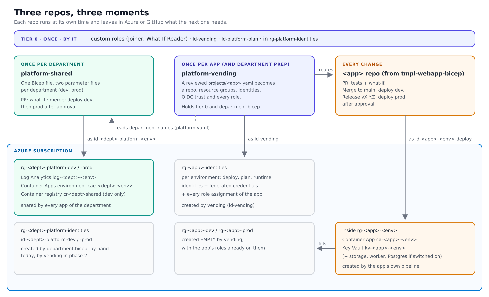
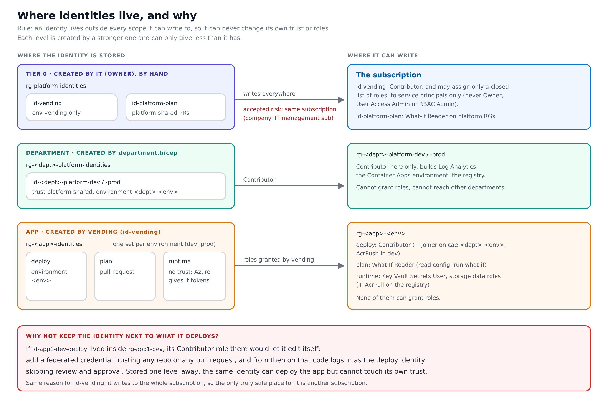
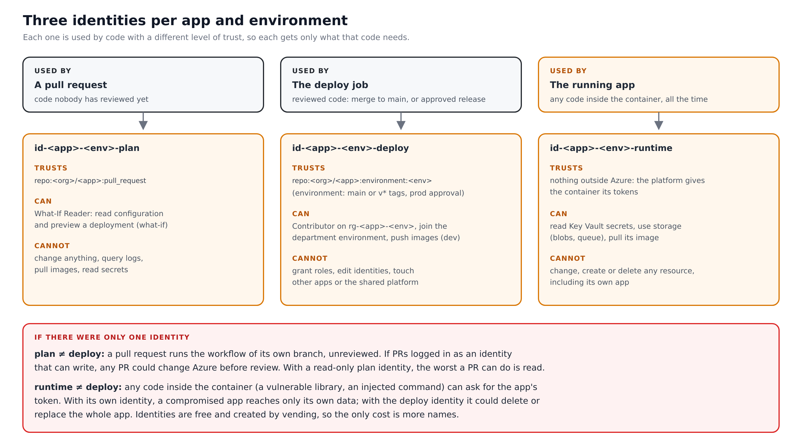
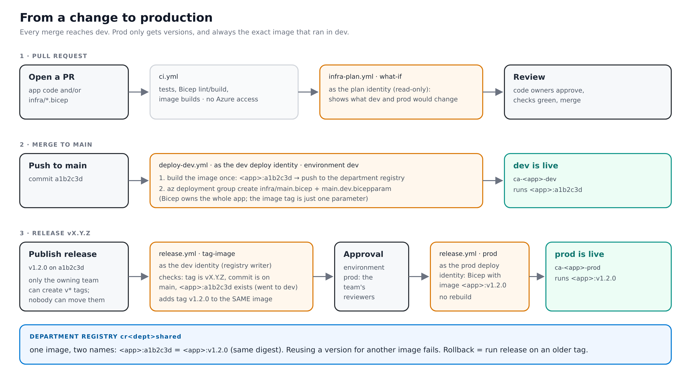
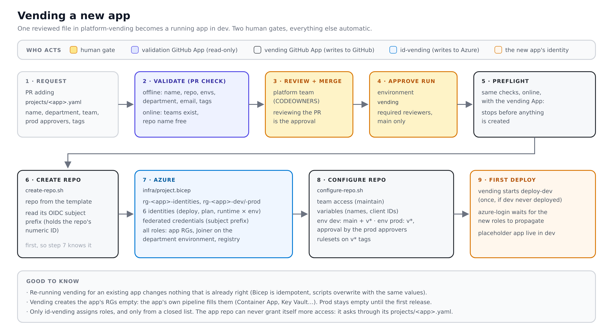
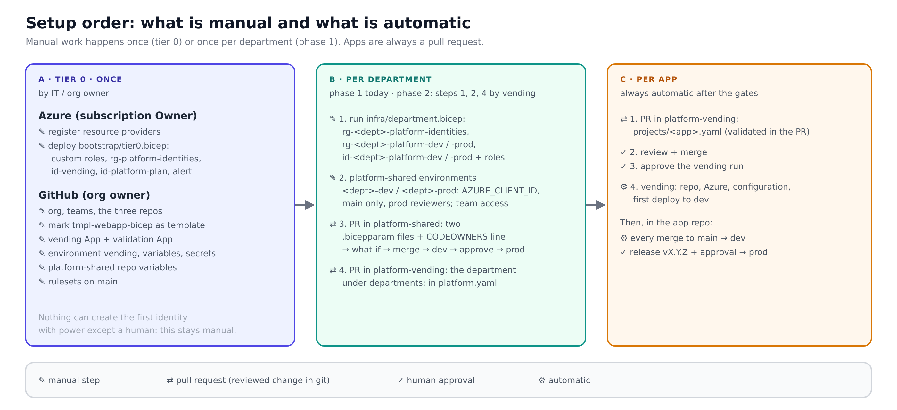

# How the platform works

A self-service platform for team apps on Azure Container Apps, built with Bicep
and GitHub Actions. A team asks for an app with a pull request; once it is
reviewed and approved, the app has a repo, Azure resource groups, identities,
permissions, pipelines and a running placeholder in dev, with no other manual
step. No secrets are stored for Azure: pipelines log in with OIDC.

## Contents

1. [The three repos](#1-the-three-repos)
2. [What lives in Azure](#2-what-lives-in-azure)
3. [Identities](#3-identities)
   - [Where identities live, and why](#31-where-identities-live-and-why)
   - [Three identities per app: plan, deploy, runtime](#32-three-identities-per-app-plan-deploy-runtime)
   - [Department and platform identities](#33-department-and-platform-identities)
   - [Custom roles](#34-custom-roles)
   - [How a pipeline logs in (OIDC)](#35-how-a-pipeline-logs-in-oidc)
4. [GitHub Apps](#4-github-apps)
5. [From a change to production](#5-from-a-change-to-production)
6. [Vending a new app](#6-vending-a-new-app)
7. [Setup from scratch](#7-setup-from-scratch)
   - [A. Tier 0 (once)](#a-tier-0-once)
   - [B. Adding a department](#b-adding-a-department)
   - [C. Adding an app](#c-adding-an-app)
8. [Security model](#8-security-model)
9. [Day-to-day operations](#9-day-to-day-operations)
10. [Known gaps and next steps](#10-known-gaps-and-next-steps)
11. [Glossary](#11-glossary)

---

## 1. The three repos



| Repo | Runs | What it does |
|---|---|---|
| **platform-shared** | Once per department, and when the shared base changes | One `infra/main.bicep` and two parameter files per department (`infra/teams/<dept>.{dev,prod}.bicepparam`). Creates what every app of a department shares: Log Analytics, the Container Apps environment and the container registry. |
| **platform-vending** | Once per app (and to prepare a department) | Turns a reviewed `projects/<app>.yaml` into a repo, resource groups, identities, OIDC trust and every role. Also holds tier 0 (`bootstrap/tier0.bicep`) and the department preparation (`infra/department.bicep`). |
| **tmpl-webapp-bicep** | Never by itself: it is copied | The template every app repo starts from: a placeholder app, the app's Bicep (Container App, Key Vault, optional storage, worker, Postgres) and its pipelines. |

The repos never call each other. Each one runs at its own moment and leaves in
Azure or GitHub what the next one needs. The only explicit link is
`platform-vending/platform.yaml`, which records the names of what
platform-shared created for each department.

Why three repos and not one:

- A GitHub template copies a whole repo, so the template must be its own repo.
- GitHub only runs workflows from `.github/workflows` at the root of a repo; each
  repo has its own triggers.
- OIDC trust is per repo: the vending identity only accepts tokens from
  platform-vending, a department identity only from platform-shared. A workflow
  in one repo cannot pretend to be another.
- They change at different paces: platform-shared when a department is added,
  vending when an app is added, the template rarely.

## 2. What lives in Azure

| Resource group | Created by | Contains |
|---|---|---|
| `rg-platform-identities` | Tier 0, by hand | `id-vending`, `id-platform-plan`, the security alert |
| `rg-<dept>-platform-identities` | `department.bicep` | `id-<dept>-platform-dev`, `id-<dept>-platform-prod` |
| `rg-<dept>-platform-dev` / `-prod` | `department.bicep` (empty), filled by platform-shared | `log-<dept>-<env>`, `cae-<dept>-<env>`, `cr<dept>shared` (dev only) |
| `rg-<app>-identities` | Vending | 6 identities (deploy, plan, runtime × dev, prod) |
| `rg-<app>-dev` / `-prod` | Vending (empty), filled by the app's pipeline | `ca-<app>-<env>`, `kv-<app>-<env>`, optional storage, worker, Postgres |

Who creates a resource group is always one level above who deploys into it.
`id-<dept>-platform-dev` is Contributor on `rg-<dept>-platform-dev` only, a role
given on the resource group; creating resource groups needs rights on the whole
subscription, which a department or app identity must not have. So the
resource group comes first, created by a stronger level, and the weaker identity
works inside it.

There is one registry per department, in dev. Images are built once, in dev, and
prod runs the same image (see [section 5](#5-from-a-change-to-production)).

## 3. Identities

Every actor that changes Azure is a user-assigned managed identity, with
federated credentials (OIDC) instead of secrets. People use their own Entra
accounts through groups; no pipeline uses a person's credentials.

### 3.1 Where identities live, and why



**Rule: an identity is stored outside every scope it can write to.**

A federated credential (the rule saying which GitHub token an identity trusts)
is part of the identity. Whoever can write to the identity can add a federated
credential to it, and from then on log in as it. So:

| If an identity can write to... | It must be stored... | Here |
|---|---|---|
| one resource group | in another resource group | app and department identities live in `*-identities` RGs, where no pipeline has rights |
| a whole subscription | in another subscription | `id-vending` (accepted risk in the test setup, see [section 8](#8-security-model)) |

Example: if `id-app1-dev-deploy` lived inside `rg-app1-dev`, its Contributor role
there would let a compromised or malicious deploy job add a federated credential
trusting any repo or any pull request. That code could then log in as the deploy
identity without review or approval. Stored in `rg-app1-identities`, the same
identity can deploy the app but cannot touch its own trust.

Each level is created by a stronger one and can only give less than it has:

```
IT (Owner)                 creates tier 0
  id-vending               creates department and app identities; assigns only a closed list of roles
    id-<dept>-platform-*   Contributor on its platform RG: builds the department base
    id-<app>-<env>-deploy  Contributor on rg-<app>-<env>: builds the app
    id-<app>-<env>-runtime data roles on rg-<app>-<env>: runs the app
```

### 3.2 Three identities per app: plan, deploy, runtime



| Identity | Used by | Trusts (OIDC subject) | Can |
|---|---|---|---|
| `id-<app>-<env>-plan` | Pull requests (what-if) | the app repo, `pull_request` | What-If Reader: read configuration, preview a deployment |
| `id-<app>-<env>-deploy` | `deploy-dev.yml`, `release.yml` | the app repo, `environment:<env>` | Contributor on `rg-<app>-<env>`, Joiner on the department environment, Repository Writer on its own image repository (dev only), attach the runtime identity |
| `id-<app>-<env>-runtime` | The running Container App | nothing outside Azure | Repository Reader on its own image repository; Key Vault Secrets User, Storage Blob and Queue Data Contributor on `rg-<app>-<env>` |

Why not one identity:

- **plan ≠ deploy.** A pull request runs the workflow of its own branch, which
  nobody has reviewed. If pull requests logged in as an identity that can write,
  any PR could change Azure before review. With a read-only identity, the worst
  a PR can do is read configuration.
- **runtime ≠ deploy.** Any code inside the container (a vulnerable library, an
  injected command) can ask for the app's token. With its own identity, a
  compromised app reaches only its own data; with the deploy identity it could
  delete or replace the whole app.
- **one set per environment.** The prod deploy identity trusts only the GitHub
  environment `prod`, which needs approval and accepts only release tags. A dev
  run cannot reach prod.

Identities are free and created by vending; the only cost is more names.

### 3.3 Department and platform identities

| Identity | Lives in | Trusts | Can |
|---|---|---|---|
| `id-vending` | `rg-platform-identities` | platform-vending, `environment:vending` | Contributor on the subscription; Role Based Access Control Administrator limited by a condition to a closed list of roles, granted to service principals only |
| `id-platform-plan` | `rg-platform-identities` | platform-shared, `pull_request` | What-If Reader on every `rg-<dept>-platform-<env>` |
| `id-<dept>-platform-<env>` | `rg-<dept>-platform-identities` | platform-shared, `environment:<dept>-<env>` | Contributor on `rg-<dept>-platform-<env>` only |

There is a single `id-platform-plan` for all departments on purpose: every pull
request of platform-shared presents the same OIDC subject, so one identity per
department would not isolate anything.

The roles `id-vending` may assign: Contributor, Managed Identity Operator,
Container Registry Repository Reader and Writer (plus AcrPull and AcrPush while a
registry is still in legacy mode), Key Vault Secrets User, Storage Blob Data
Contributor, Storage Queue Data Contributor, Container Apps Environment Joiner,
What-If Reader. Never
Owner, User Access Administrator or RBAC Administrator, so nothing it creates can
grant roles in turn.

### 3.4 Custom roles

Both are created once by tier 0, with fixed GUIDs that `platform.yaml` repeats.

- **Container Apps Environment Joiner** (`read` + `join/action` on a Container
  Apps environment). An app's Container App must "join" its department's shared
  environment. Without this role the deploy identity would need Contributor on
  the platform resource group, and could change or delete the environment every
  other app runs in. One definition serves every department: isolation comes from
  where it is assigned (one environment), not from the definition.
- **What-If Reader** (`*/read` + deployment `validate`/`whatIf`, minus Log
  Analytics queries, activity logs and image pulls). For identities that run pull
  request code. Plain Reader would let unreviewed code query production logs and
  pull images. What-if runs with `--validation-level ProviderNoRbac`, which checks
  read access instead of write access.

### 3.5 How a pipeline logs in (OIDC)

1. The job asks GitHub for a signed token stating, for example, "repo
   platform-vending, environment vending" (the *subject*).
2. It sends that token to Entra ID and asks to act as `id-vending`.
3. Entra checks the identity's federated credentials: issuer
   `token.actions.githubusercontent.com`, exact subject, audience
   `api://AzureADTokenExchange`. If they match, it returns an Azure token valid
   for about an hour.

Nothing is stored that could be stolen and reused later.

**Subjects use numeric IDs.** GitHub sends, by default for new repos,
`repo:<org>@<orgId>/<repo>@<repoId>:...` instead of plain names, so a deleted
and recreated repo with the same name does not inherit the trust. Federated
credentials are built from the exact prefix GitHub reports
(`gh api repos/<org>/<repo>/actions/oidc/customization/sub --jq .sub_claim_prefix`),
which works with either format. This is why vending creates the app repo before
its Azure identities.

**Role assignments take minutes to apply.** Azure RBAC is eventually
consistent. Every app login goes through `.github/actions/azure-login`, which
repeats a complete login with a fresh GitHub token, with a growing delay, for up
to 10 minutes, until the identity can use the subscription. This matters for the
first deploy, started seconds after vending creates the roles.

## 4. GitHub Apps

A GitHub App is a machine identity on the GitHub side, like a managed identity on
the Azure side: its own permissions, short-lived tokens (one hour), owned by the
org and not by a person. Its actions show up as `<app-name>[bot]`. Unlike Azure
OIDC, a GitHub App authenticates with a private key, which is why these keys are
the only secrets in the whole setup.

| App | Permissions | Key stored in | Used by | Why it exists |
|---|---|---|---|---|
| **tiago-platform-vending** | Repository: Administration, Variables, Environments, Custom properties, Actions, Contents (read/write). Organization: Members (read) | Secret of the `vending` environment of platform-vending (approval, `main` only) | The vend job | Create the app repo from the template, give the team access, create environments, variables, rulesets, write CODEOWNERS, start the first deploy. The workflow's own `GITHUB_TOKEN` only reaches its own repo. |
| **tiago-platform-vending-check** | Organization: Members (read); Repository: Metadata (read) | Repo secret of platform-vending, available to pull requests | The `validate` job of pull requests | Check a request against GitHub before merge: the teams exist, the repo name is free. |

Why two apps: pull requests run unreviewed code, so they must never get the key
that can write. A leaked validation key only reveals which teams and repos exist;
a leaked vending key could create and reconfigure repos. Separating them is the
same idea as `plan` and `deploy` on the Azure side.

Why not a personal access token: it acts as a person, with all of that person's
rights, and stops working when the person leaves.

## 5. From a change to production



| Workflow (app repo) | Trigger | Runs as | Does |
|---|---|---|---|
| `ci.yml` | Every PR and push | No Azure access | Tests, Bicep lint and build, image build |
| `infra-plan.yml` | PRs touching `infra/`, the workflow or `.github/actions/` | Plan identity | What-if for dev and prod |
| `deploy-dev.yml` | Push to `main` | Dev deploy identity | Builds `<app>:<sha>` once, pushes it, deploys `infra/main.bicep` to dev |
| `release.yml` | Tag `vX.Y.Z` (a published release) | Dev identity, then prod deploy identity | `tag-image` adds the version to the image dev already runs; after approval, `prod` deploys `<app>:vX.Y.Z` |

Principles:

- **Every merge reaches dev; prod only gets versions.** Prod deploys from a
  release, never from a merge, so there is no queue of pending prod runs and every
  prod deploy has a name.
- **Build once, promote.** Prod never rebuilds. `tag-image` refuses a version
  whose commit is not on `main` or whose image never went to dev, and refuses to
  move an existing version to another image.
- **Only the dev identity writes to the registry.** The prod identity cannot push
  images; `tag-image` borrows the dev identity for that one step, which is why
  environment `dev` accepts `main` and `v*` tags while `prod` accepts `v*` tags
  only.
- **Release tags are protected** by rulesets: only the owning team creates `v*`
  tags, nobody moves or deletes them.
- **Bicep owns the app.** Sizing, scale and environment variables live in
  `infra/main.bicep` and its parameter files; the deploy only passes the image
  tag. Changes made in the portal are undone by the next deploy.
- **Resources appear on first deploy.** Vending leaves `rg-<app>-dev` and
  `rg-<app>-prod` empty; dev fills on the first deploy (started by vending), prod
  on the first approved release.

## 6. Vending a new app



Validation happens twice with the same script (`scripts/validate-project.sh`):

| When | How | Checks |
|---|---|---|
| In the pull request | Offline for every record; online (validation App) for the records the PR adds or changes | Name format, file name, `repo` = `<org>/<name>`, department and its environments exist, team slugs, owner email, cost centre, `tags.dept` = department; online: teams exist, repo free or created from the template |
| Preflight, in the vend job before anything is created | Online, with the vending App | The same, again: the last barrier |

A request with a wrong team fails the PR check; if it is merged anyway, Preflight
stops the run before any repo or Azure resource exists.

## 7. Setup from scratch



Commands assume the Azure CLI with Bicep, run from a clone of platform-vending,
logged in with `az login` (use `--use-device-code` in WSL).

### A. Tier 0 (once)

**Azure, as subscription Owner** (central IT at the company):

1. Register the resource providers (once per subscription; pipelines cannot do
   it, it needs subscription-level rights):
   ```
   for p in Microsoft.ManagedIdentity Microsoft.OperationalInsights Microsoft.App \
            Microsoft.ContainerRegistry Microsoft.KeyVault Microsoft.Insights; do
     az provider register -n $p
   done
   ```
   Add `Microsoft.Storage` / `Microsoft.DBforPostgreSQL` when an app needs them.
2. Fill `bootstrap/tier0.bicepparam`: region, tags, the OIDC subject prefixes of
   platform-vending and platform-shared, the alert email. Review, then deploy:
   ```
   az deployment sub what-if -l <region> -n tier0 -f bootstrap/tier0.bicep -p bootstrap/tier0.bicepparam
   az deployment sub create  -l <region> -n tier0 -f bootstrap/tier0.bicep -p bootstrap/tier0.bicepparam
   ```
   It creates the two custom roles, `rg-platform-identities`, `id-vending` and
   `id-platform-plan` with their federated credentials, id-vending's two role
   assignments and an email alert on any federated credential change. Outputs:
   `vendingClientId`, `platformPlanClientId`, `platformPlanPrincipalId`.

**GitHub, as org owner:**

1. Org, teams (platform team plus one per department), the three repos;
   mark `tmpl-webapp-bicep` as a template repository.
2. Vending GitHub App (permissions in [section 4](#4-github-apps)), no webhook,
   installed on **all repositories**, private key generated.
3. Validation GitHub App (Members read, Metadata read), installed on all
   repositories, private key generated.
4. platform-vending:
   - environment `vending`: required reviewers = platform team, deployment
     branches `main`; variables `VENDING_CLIENT_ID` (= `vendingClientId`),
     `VENDING_APP_CLIENT_ID`; secret `VENDING_APP_PRIVATE_KEY`;
   - repo variables `AZURE_TENANT_ID`, `AZURE_SUBSCRIPTION_ID`, `VALIDATE_APP_CLIENT_ID`;
     repo secret `VALIDATE_APP_PRIVATE_KEY`.
5. platform-shared: repo variables `AZURE_TENANT_ID`, `AZURE_SUBSCRIPTION_ID`,
   `AZURE_PLAN_CLIENT_ID` (= `platformPlanClientId`).
6. Rulesets on `main` of every repo: pull request required, checks green, code
   owner review.

### B. Adding a department

Phase 1 (today): steps 1, 2 and 4 by hand. Phase 2 moves them into vending.

1. **Azure: prepare the department** with `infra/department.bicep`:
   ```
   az deployment sub create -l <region> -n dept-<dept> -f infra/department.bicep -p \
     team=<dept> \
     platformSharedSubjectPrefix="$(gh api repos/<org>/platform-shared/actions/oidc/customization/sub --jq .sub_claim_prefix)" \
     planPrincipalId=<platformPlanPrincipalId> \
     whatIfReaderRoleId=<azure.roles.whatIfReader from platform.yaml> \
     tags='{"owner":"...","cost-centre":"..."}'
   ```
   It creates `rg-<dept>-platform-identities` with `id-<dept>-platform-dev/-prod`
   (trusting platform-shared, `environment:<dept>-<env>`), the empty
   `rg-<dept>-platform-dev/-prod`, Contributor for each identity on its own RG,
   and What-If Reader for `id-platform-plan`. Outputs the deploy client IDs.

   Why a separate `rg-<dept>-platform-identities`: the department identities are
   Contributor on their platform RGs, so they must be stored outside them
   ([section 3.1](#31-where-identities-live-and-why)).
2. **GitHub, platform-shared:**
   - give the department team Write access to the repo;
   - environments `<dept>-dev` and `<dept>-prod`: variable `AZURE_CLIENT_ID`
     (the matching output), deployment branches `main`; on `-prod`, required
     reviewers = the department team. Names must match exactly: the federated
     credentials check them.
3. **Pull request in platform-shared**: `infra/teams/<dept>.dev.bicepparam` and
   `<dept>.prod.bicepparam` (`team` = lowercase letters and digits, max 10; it is
   part of the registry name) plus a CODEOWNERS line. The PR shows the what-if;
   merging deploys dev, then prod after approval.
4. **Pull request in platform-vending**: the department under `departments:` in
   `platform.yaml` (resource groups, environment names, registry), following the
   shape documented there.

### C. Adding an app

1. Pull request in platform-vending adding `projects/<app>.yaml`:
   ```yaml
   name: my-app                    # 3-16 chars; repo and Azure names
   department: aidelivery          # a key under departments: in platform.yaml
   repo: <org>/my-app
   team: ai-delivery-team          # gets maintain access
   prodApprovers: ai-delivery-team # required reviewers on prod
   environments: [dev, prod]
   tags: { dept: aidelivery, owner: someone@example.com, cost-centre: "1234" }
   ```
2. Review and merge; approve the run on the `vending` environment.
3. Done: the repo exists with CODEOWNERS set to the team, dev runs the placeholder
   app. The team replaces `app/`, adjusts `infra/main.<env>.bicepparam`, and releases
   `v1.0.0` when ready for prod.

## 8. Security model

| Threat | Control |
|---|---|
| Unreviewed code changes Azure | PRs only get read-only identities (plan, What-If Reader); deploy identities trust GitHub environments that accept only `main` (dev) or `v*` tags (prod) |
| A pipeline widens its own access | No pipeline identity can grant roles except `id-vending`, from a closed list; identities live outside the scopes they write to |
| One department touches another | Department identities are Contributor on their own RG only; the Joiner role is assigned per environment; CODEOWNERS and per-department environments in platform-shared |
| A compromised app destroys infrastructure | The runtime identity only has data roles on its own RG |
| One app reads or replaces another app's images | Registries run in ABAC mode: each app's identities get the repository roles with a condition on their own repository (`<registry>/<app>`); AcrPull/AcrPush are not honoured |
| A compromised third-party action steals a token | Every action pinned by commit SHA; Dependabot proposes updates |
| Someone changes who an identity trusts | Email alert on any federated credential write or delete |
| A repo is recreated with the same name to inherit trust | OIDC subjects with numeric org and repo IDs |
| A release is altered after the fact | Tag rulesets (immutable `v*`), `tag-image` refuses to move a version |
| Secrets in code or pipelines | No Azure secrets at all (OIDC); apps read secrets from Key Vault by identity; the only secrets are the two GitHub App keys |

Accepted risks (test setup):

- `id-vending` is stored in the subscription where it is Contributor, so a stolen
  vending token could edit `id-vending` itself. Mitigated by SHA pinning, the
  `vending` approval and the alert. At the company: deploy tier 0's
  `rg-platform-identities` in IT's management subscription.
- `id-vending` can assign Contributor anywhere in the subscription (needed for
  every deploy identity), so a stolen token could create a Contributor backdoor,
  but never one that can grant roles.

## 9. Day-to-day operations

| Task | How |
|---|---|
| Deploy to dev | Merge to `main` of the app repo |
| Release to prod | Publish a release `vX.Y.Z` on `main`, approve `prod` |
| Roll back dev | Run `deploy-dev` by hand with `image-tag` = an earlier commit SHA |
| Roll back prod | Run `release` on an earlier tag: `gh workflow run release.yml --ref v1.2.2` |
| Change app resources (storage, worker, sizing) | PR in the app repo changing `infra/main.<env>.bicepparam`; the PR shows the what-if |
| Give an app a new role | PR in platform-vending (the role must be in id-vending's list); app repos cannot grant roles |
| Re-apply vending to an app | **Run workflow** on `vend-project` with `projects/<app>.yaml`; idempotent |
| Update the template | PR in `tmpl-webapp-bicep`; existing app repos need the same change through their own PRs |
| Costs by department or app | Cost Management, group by tag `dept`, `project` or `cost-centre` |

## 10. Known gaps and next steps

- **Departments through vending (phase 2):** `departments/<dept>.yaml` running
  `department.bicep` and configuring the platform-shared environments.
- **Template updates do not reach existing apps.** Move the workflows to
  reusable workflows in a central repo, or adopt a scaffolding tool with updates
  (Copier).
- **Rulesets on `main`** of every repo, so red checks and missing reviews block
  merges.
- **Retiring an app or department** is not automated.
- **Entra app registrations** (user sign-in, Graph or Dynamics APIs) are outside
  Bicep: they need Graph permissions no pipeline has.
- Open decisions for the company: tag set, naming, dev/prod subscriptions,
  networking (VNet, private endpoints), shared or per-app Postgres, approvers.

## 11. Glossary

| Term | Meaning |
|---|---|
| Bicep | Azure's language to declare resources; `.bicep` = what, `.bicepparam` = the values for one deployment |
| what-if | Preview of what a Bicep deployment would change, applying nothing |
| Managed identity | An Azure identity for a workload, with no password |
| Federated credential | The rule on an identity saying which external (GitHub) token it trusts |
| OIDC subject | The part of GitHub's token that says which repo, branch or environment is running |
| GitHub environment | A deploy target with rules: reviewers, allowed branches or tags, its own variables and secrets |
| Container Apps environment | The shared space (network, logs, compute) where a department's Container Apps run |
| Tier 0 | The one-off bootstrap that creates the first identities with power; always manual |
| Vending | Creating a project automatically from an approved request |
